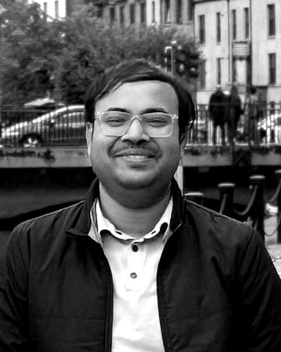

```{=html}
<div class="column-screen">
<section class="hero wrap">
  <div class="hero-photo">
    
  </div>
  <div class="hero-text">
    <h1 class="hero-name">Nitish Nigam</h1>
    <p class="hero-position">Behavioural environmental economist working on public policy</p>
    <p class="hero-role">Assistant Professor of Economics, Chandragupt Institute of Management Patna</p>
    <nav class="hero-links" aria-label="Contact and profiles">
      <a class="primary" href="mailto:nitish@cimp.ac.in">Email</a>
      <a href="https://scholar.google.com/citations?user=vLehcNkAAAAJ&amp;hl=en">Google Scholar</a>
      <a href="https://orcid.org/0000-0002-9835-9550">ORCID</a>
      <a href="https://www.linkedin.com/in/thenitishnigam/">LinkedIn</a>
      <a href="cv.html">CV</a>
    </nav>
  </div>
</section>
</div>
```

::: {.column-screen}
::: {.wrap}
::: {.bio}
Nitish Nigam is a behavioural environmental economist working on public policy. He studies the decisions that shape environmental outcomes, from a household weighing an electric vehicle to a farmer deciding whether to adopt climate-resilient practices, and asks how public policy can be designed around the way people actually make those choices.

His research combines discrete choice experiments, causal inference and large-scale primary surveys, much of it fielded in Bihar, and has appeared in the *Journal of Environmental Management* and the *International Journal of Social Economics*. He is Project Director of an ICSSR-funded study on climate-smart agriculture adoption and Co-Principal Investigator on studies for the Bihar State Biodiversity Board and the Government of Bihar.

He is an Assistant Professor of Economics at the Chandragupt Institute of Management Patna, where he also earned his doctorate (FPM) in Economics. Before joining the faculty, he was a Research Associate with the State Transformation Cell of the State Support Mission (NITI Aayog).
:::
:::
:::

::: {.band .column-screen}
::: {.wrap}
## Research focus

::: {.focus-grid}

::: {.focus}
### Behaviour and the energy transition
What drives households to adopt or reject electric vehicles, measured through choice experiments with consumers in Bihar, and which state policies shift those choices.
:::

::: {.focus}
### Farmers' decisions under climate risk
Why farmers take up or pass over climate-smart practices, and which climate-resilient interventions farmers in Bihar's aspirational blocks value most.
:::

::: {.focus}
### Biodiversity and natural resource governance
How urban biodiversity is governed in Bihar, and how biological resources are harvested, traded and valued, in studies for the Bihar State Biodiversity Board.
:::

::: {.focus}
### Institutions and public programmes
Whether local institutions make agricultural schemes work for beneficiary households, and whether female supervision raises women's participation in public employment programmes.
:::

:::
:::
:::

::: {.column-screen}
::: {.wrap}
::: {.engage}

::: {.engage-text}
## Policy engagement

His research is designed to be used. He works with government agencies on the questions they face, and has spent time inside government as well as alongside it.

```{=html}
<ul class="partner-list">
  <li><strong>NITI Aayog</strong> <span>State Support Mission and DMEO</span></li>
  <li><strong>Government of Bihar</strong> <span>Planning and Development Department</span></li>
  <li><strong>Bihar State Biodiversity Board</strong></li>
  <li><strong>Indian Council of Social Science Research</strong></li>
  <li><strong>Ministry of MSME</strong> <span>Government of India</span></li>
</ul>
```

[Policy and consulting work](policy.qmd)
:::



:::

::: {.section-head}
## Selected research

[All research](research.qmd)
:::

::: {#featured}
:::

::: {#latest-writing}
:::
:::
:::
