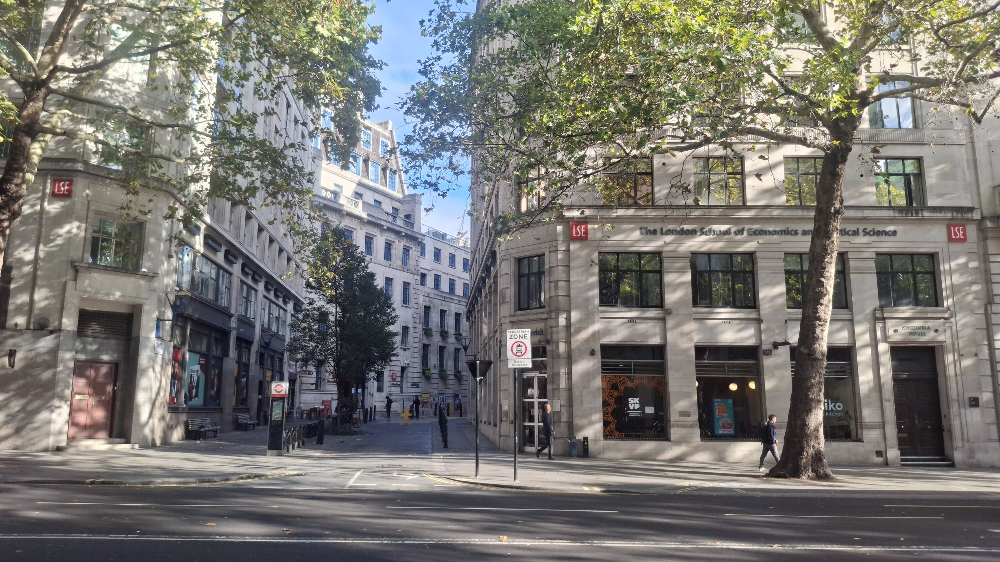
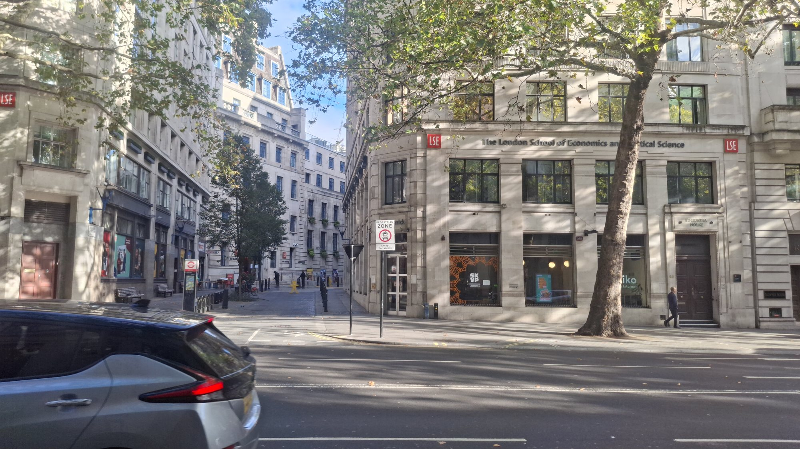
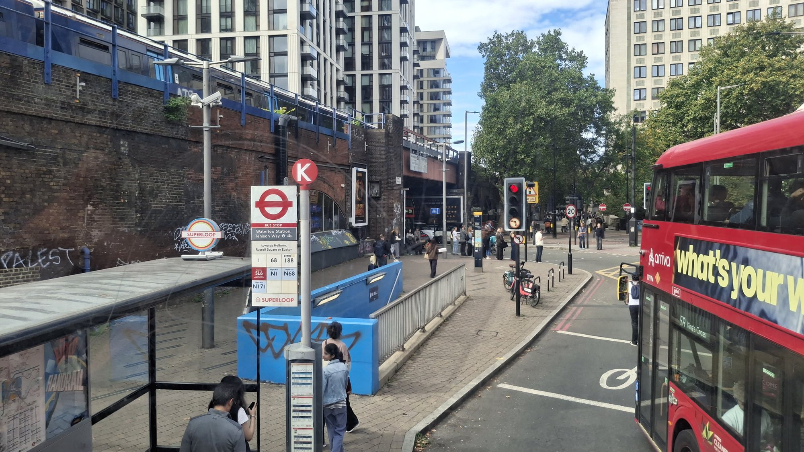

::: {.gallery layout-ncol=1}
{group="london" fig-alt="LSE buildings on Aldwych with plane trees and a quiet street"}

{group="london" fig-alt="Corner of an LSE building on Aldwych with a car passing in the foreground"}

{group="london" fig-alt="Bus stop near Waterloo station with a red double-decker bus and railway arches"}
:::
